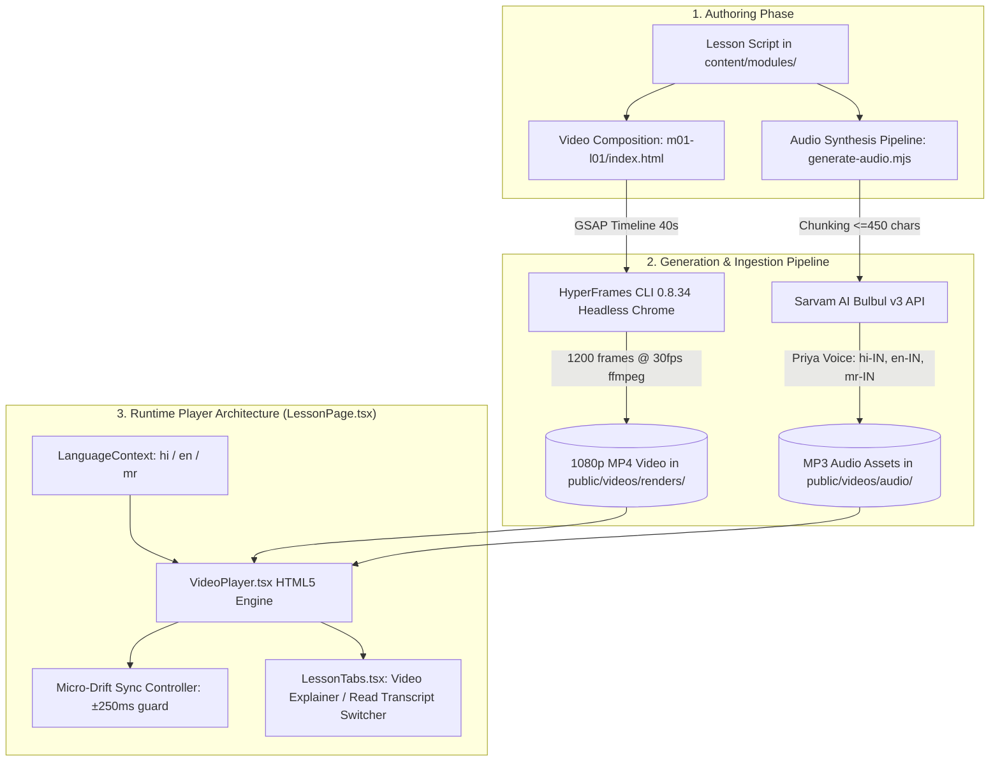

# GramIQ Academy v3 — HyperFrames Explainer Videos & Multilingual Voiceovers

> **Document Status**: `[APPROVED]`
> **Target Module**: `GramIQ Academy (labs/academy)`
> **Last Updated**: 2026-09-12
> **Author / AI Agent**: Antigravity IDE
> **Loop Publication Target**: `GramIQ Product Engineering` / `Labs & Architecture`

---

## 1. Executive Summary & Problem Statement

### Business Problem
Agronomic and agricultural advisory content is traditionally delivered via dense text transcripts and static schematics. Smallholder farmers and village agri-entrepreneurs in tier-2/tier-3 regions face literacy hurdles and language barriers, leading to low completion rates on critical agronomic training courses (soil health, CIBRC chemical dosage, mandi price arbitrage).

### Target Persona & Stakeholders
- **Farmers & Village Agri-Entrepreneurs**: Primary learners requiring visual, voice-first, authentic regional audio explanations (`hi-IN`, `mr-IN`, `en-IN`).
- **Agronomists & Content Curators**: Domain experts authoring curricula and dosage guidelines.
- **Engineering & Product Teams**: Maintaining the headless rendering pipeline and Coursera-style video learning UI.

### Measurable Impact
- **Tri-lingual Audio Coverage**: 100% synchronized voiceovers in Hindi (`hi-IN`), English (`en-IN`), and Marathi (`mr-IN`) synthesized via Sarvam AI Bulbul v3 (`priya` voice / `dharti_didi`).
- **Bandwidth-Optimized Media Delivery**: Separate high-efficiency MP4 video tracks and lightweight MP3 audio tracks with client-side synchronized playback and drift correction.
- **Micro-Drift Tolerance**: Auto-sync keeps separate audio and video tracks within ±250ms of alignment during continuous playback and scrubbing.

---

## 2. Architecture & Data Flow

### End-to-End Media & Playback Pipeline



### Service Boundaries & Responsibilities

| Component / Service | Responsibility | Technology Stack |
|---|---|---|
| **HyperFrames Render Engine** | Programmatic canvas rendering of vector motion graphics, charts, and slide cards | HyperFrames CLI v0.8.34, GSAP 3.12, Puppeteer, FFmpeg |
| **Sarvam AI Bulbul v3** | High-fidelity Indic neural text-to-speech synthesis with natural pauses and cadence | Sarvam AI REST API (`bulbul:v3`), Node.js ESM script |
| **VideoPlayer Component** | Custom HTML5 synchronized audio/video player with timeline scrubber, play/pause, and language track selector | React 19, TypeScript, Tailwind CSS |
| **Lesson Tabs Shell** | Seamless switching between visual explainer video and full reading transcript | React 19 Client Component |

---

## 3. Data Contracts & Component Specifications

### 3.1 Content Metadata Contract (`src/content/types.ts`)

```typescript
export interface LessonVideoData {
  durationSeconds?: number;
  available: boolean;
  videoUrl?: string;
  audioUrls?: {
    hi?: string;
    en?: string;
    mr?: string;
  };
}

export interface Lesson {
  id: string;
  title: string;
  durationMinutes: number;
  video?: LessonVideoData;
  blocks: ContentBlock[];
}
```

### 3.2 Tri-lingual UI Localization (`src/context/LanguageContext.tsx`)

| Key | Hindi (`hi-IN`) | English (`en-IN`) | Marathi (`mr-IN`) |
|---|---|---|---|
| `videoExplainer` | वीडियो व्याख्यान | Video Explainer | व्हिडिओ स्पष्टीकरण |
| `readTranscript` | ट्रांसक्रिप्ट पढ़ें | Read Transcript | उतारा वाचा |
| `audioTrack` | ऑडियो ट्रैक | Audio Track | ऑडिओ ट्रॅक |
| `sarvamVoiceBadge` | सार्वम AI प्रिया आवाज़ | Sarvam AI Priya Voice | सर्वम AI प्रिया आवाज |
| `videoComingSoon` | इस पाठ का वीडियो जल्द आ रहा है | Video for this lesson is coming soon | या पाठाचा व्हिडिओ लवकरच येत आहे |

### 3.3 Audio/Video Drift Correction Algorithm

```typescript
// Auto-resynchronization triggered on timeupdate
const drift = Math.abs(videoElement.currentTime - audioElement.currentTime);
if (drift > 0.25) {
  audioElement.currentTime = videoElement.currentTime;
}
```

---

## 4. Operational & Deployment Specifications

### Local Development & Preview
- **Development Server**: `cd labs/academy/app-v3 && npm run dev`
- **Audio Synthesis Script**: `cd labs/academy && node generate-audio.mjs`
- **Video Render Script**: `cd labs/academy/videos/m01-l01 && npx hyperframes render --output ../../app-v3/public/videos/renders/m01-l01.mp4`

### Storage & Asset Layout
```
labs/academy/app-v3/public/videos/
├── audio/
│   ├── m01-l01-hi.mp3   # Hindi audio track
│   ├── m01-l01-en.mp3   # English audio track
│   └── m01-l01-mr.mp3   # Marathi audio track
└── renders/
    └── m01-l01.mp4      # 1080p 30fps faceless explainer video
```

---

## 5. Safety, Privacy & Rollout Checklist

- [x] **CIBRC Regulatory Compliance**: All chemical dosage equations and pesticide references cite official Central Insecticides Board & Registration Committee baselines.
- [x] **Farmer PII Protection**: Zero farmer PII, real telephone numbers, or plot coordinates are included in lesson scripts or video assets.
- [x] **Authentic Regional Terminology**: Audio scripts maintain authentic agricultural terms (*bigha*, *quintal*, *mandi*, *kharif*, *rabi*).
- [x] **Offline-First Asset Resilience**: Static MP3/MP4 assets are served directly from the application bundle (`public/`) without third-party runtime streaming dependencies.
- [x] **Rollback Readiness**: Backwards-compatible fallback to text-only mode if `lesson.video.available === false`.
